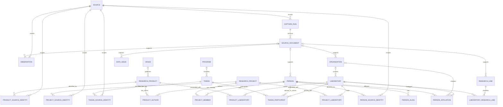

# CIC catalog database

`01_schema.sql` defines the standalone `raw` and `catalog` schemas and enables
pgvector. PostgreSQL must have the pgvector extension package installed; the
SQL statement enables it in the database. The full data snapshot is generated
at `data/cic_scrape.sql` by `scraper/build_postgres_export.py`.

The export creates a separate database named `cic_scrape`, so it can coexist
with `theiss` and `saber_scrape` on the same PostgreSQL instance. Restore it with:

```bash
psql -d postgres -f data/cic_scrape.sql
```

The target database must not already exist. The dump includes the schema,
pgvector extension activation, CIC catalog rows, source identities, and capture
provenance. The raw HTML bodies are kept in the local ignored archive under
`scraper/data/`; PostgreSQL stores their relative paths and SHA-256 hashes.

## Entity relationship diagram



`catalog.embedding` stores versioned pgvector vectors for theses, research
products, or projects. Its `(entity_type, entity_id)` pair is polymorphic, so
it does not use a foreign key to just one of those entity tables. `catalog.data_issue`
keeps quality warnings; `catalog.observation` preserves source assertions and
conflicts. Source identity tables preserve external IDs without treating them
as globally unique. `person_affiliation` and the product/project join tables
allow people and work to relate to multiple institutions or labs.

`thesis_participant.role` distinguishes primary advisor, co-advisor, committee
member, and unknown. The thesis's `assigned_laboratory_id` is attached only to
the primary-advisor participant. Committee members listed without roles by the
CIC thesis detail page are not guessed to be co-advisors.
